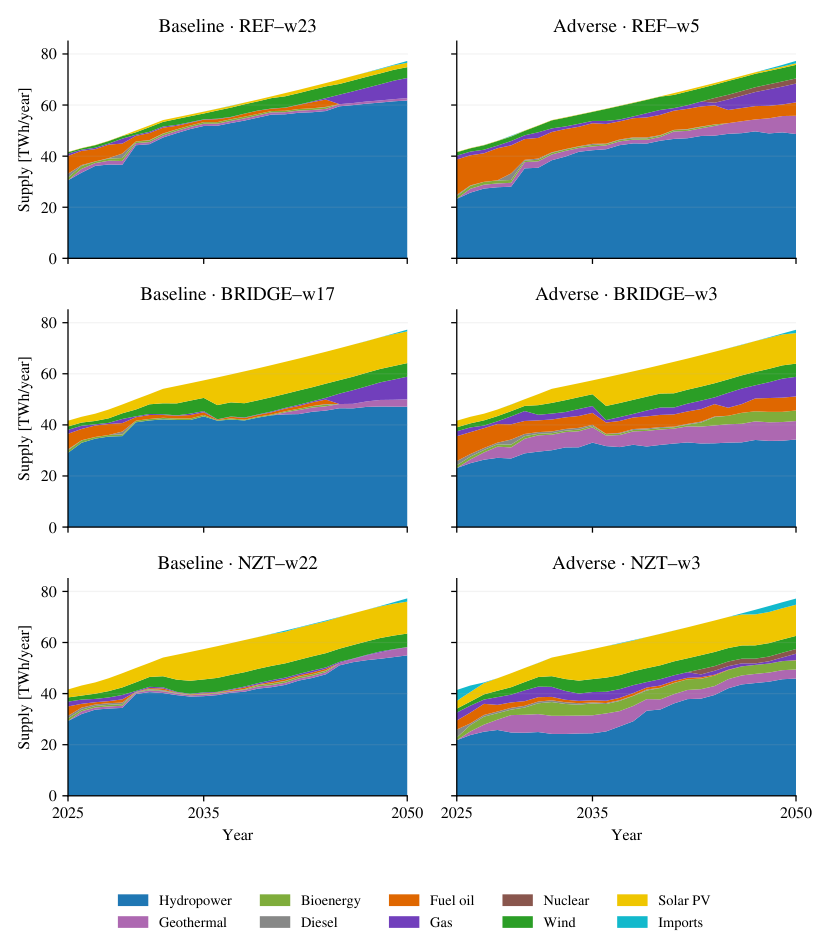
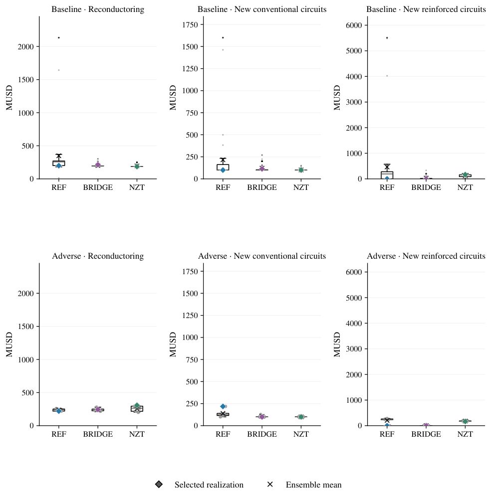

# PARAMO Ecuador Results Explorer

**[Explore the interactive results](https://wilianguaman.github.io/PARAMO-Ecuador/)**

PARAMO is a research project on long-term generation and transmission planning under hydrological uncertainty, developed through collaboration between **[ESPOL](https://www.espol.edu.ec/)** and the **[Mineral and Energy Economy Research Institute of the Polish Academy of Sciences (MEERI PAS)](https://pan.pl/en/facility/mineral-and-energy-economy-research-institute-of-the-polish-academy-of-sciences/)**.

The explorer follows Ecuador’s electricity system from 2025 to 2050. It compares REF, BRIDGE and NZT under Baseline and Adverse conditions, with annual investment decisions evaluated alongside monthly generation and reservoir operation.

## Explore

Choose a pathway and hydrological case, move the **year slider**, and filter monthly plots with **Wet / Dry**. Hover over charts and network corridors for values. Figures can be exported as PNG or SVG; detailed views also provide CSV downloads.

- **Generation:** installed capacity, annual additions and monthly electricity supply.
- **Transmission:** existing-circuit reconductoring, new conventional circuits and new reinforced circuits, shown separately on maps and annual investment heatmaps.
- **Reservoirs:** monthly storage, plant-level water balances and cascade operation.
- **Performance:** discounted costs, direct CO₂ emissions and energy not served (ENS).
- **All figures:** the complete research figure collection, with original files for download.

## Reading the results

The national 24-node case contains 100 Baseline realizations and five Adverse realizations per pathway. Detailed profiles follow REF–w23, BRIDGE–w17 and NZT–w22 in Baseline, and REF–w5, BRIDGE–w3 and NZT–w3 in Adverse. The interface distinguishes these individual plans from ensemble means and empirical intervals.

The six-node case is a separate planning study. Its scenarios and numerical results should be interpreted within that model. [Methods and units](docs/METHODOLOGY.md) · [Data provenance](docs/DATA_PROVENANCE.md).

## Related publications

Guamán, W., Benalcazar, P., Cordova-Garcia, J., and Torres, M. (2025). *An integrated framework for the optimal expansion of hydro-dependent power systems under water-resource uncertainty*. **Energy Conversion and Management: X, 28**, 101297. [Read the publication](https://doi.org/10.1016/j.ecmx.2025.101297).

## Use and citation

Open `ABRIR_DASHBOARD.bat` for local viewing. No solver is needed to explore the results. See [data access](docs/DATA_ACCESS.md) for additional research-data requests.

Guamán Cuenca, W. (2026). *PARAMO Ecuador Results Explorer* (1.0). [Repository](https://github.com/WilianGuaman/PARAMO-Ecuador). Machine-readable citation: [CITATION.cff](CITATION.cff).

[Code and data licenses](LICENSES.md).
