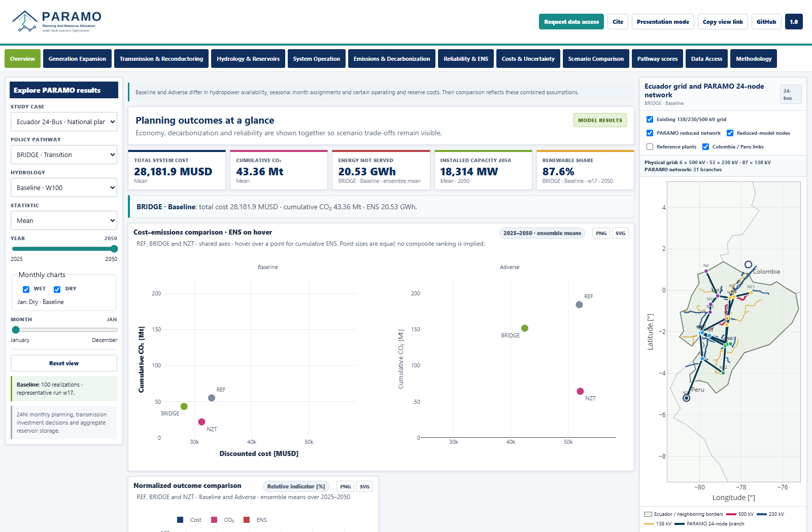
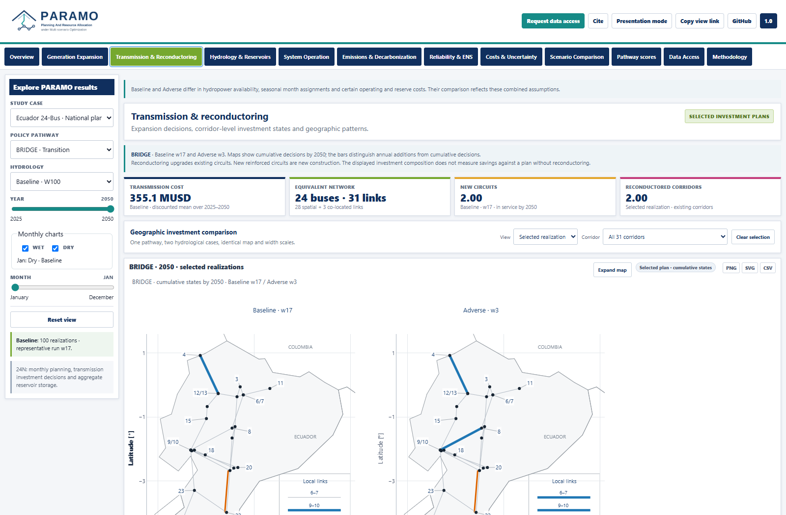

# PARAMO Ecuador Results Explorer

**[Explore the interactive results](https://wilianguaman.github.io/PARAMO-Ecuador/)**

PARAMO is a research project on long-term generation and transmission planning under hydrological uncertainty, developed through collaboration between **[Escuela Superior Politécnica del Litoral (ESPOL)](https://www.espol.edu.ec/)** and the **[Mineral and Energy Economy Research Institute of the Polish Academy of Sciences (MEERI PAS)](https://pan.pl/en/facility/mineral-and-energy-economy-research-institute-of-the-polish-academy-of-sciences/)**.

Use the explorer to compare generation and transmission expansion, examine monthly reservoir operation, and assess costs, emissions and energy not served over 2025–2050. The national case compares REF, BRIDGE and NZT under Baseline and Adverse conditions; a separate six-node study provides plant and corridor results.

## Explore

Select a **study case**, **pathway** and **hydrological case**. Use the **year and month sliders** to move through the horizon. In the national case, the statistic selector distinguishes ensemble summaries from the selected realization.

Open a results tab, hover for values, and select a corridor or hydropower asset where those controls are available. Use **Copy view link** to share the current selection. Charts support PNG and SVG export; CSV export is available in supported views.

- **Generation:** installed capacity, annual additions and monthly electricity supply.
- **Transmission:** existing-circuit reconductoring, new conventional circuits and new reinforced circuits, shown separately on maps, annual addition bars and cumulative comparisons for 2025 and 2050.
- **Reservoirs:** monthly storage, generation and releases for selected plants in the six-node case, and aggregate storage and water operation in the national case.
- **Performance:** discounted costs, direct CO₂ emissions and energy not served (ENS).
- **Pathway scores:** calculated economic, environmental and supply-adequacy contributions under Baseline and Adverse.

*Click either preview to open the corresponding interactive view.*

## Reading the results

The national 24-node case contains 100 Baseline realizations and five Adverse realizations per pathway. Detailed profiles follow REF–w23, BRIDGE–w17 and NZT–w22 in Baseline, and REF–w5, BRIDGE–w3 and NZT–w3 in Adverse. The interface distinguishes these individual plans from ensemble means and empirical intervals.

Baseline and Adverse differ in availability, seasonal assignments and some operating costs, so their comparison reflects the combined assumptions. ENS measures monthly energy deficit, not the frequency or duration of interruptions.

The six-node case uses its own scenarios and assumptions; its values should not be directly compared with the national case. [Methods and units](docs/METHODOLOGY.md) · [Data provenance](docs/DATA_PROVENANCE.md).

The public data cover aggregate results and selected trajectories. The optimization code, full input databases, plant-level hydraulic balances and complete realization archives are not included.

## Related publications

Guamán, W., Benalcazar, P., Cordova-Garcia, J., and Torres, M. (2025). *An integrated framework for the optimal expansion of hydro-dependent power systems under water-resource uncertainty*. **Energy Conversion and Management: X, 28**, 101297. [Read the publication](https://doi.org/10.1016/j.ecmx.2025.101297).

## Use and citation

Open `ABRIR_DASHBOARD.bat` for local viewing. No solver is needed to explore the results. See [data access](docs/DATA_ACCESS.md) for additional research-data requests.

Guaman, W., & Benalcazar, P. (2026). *PARAMO Ecuador Results Explorer* (1.0). [Repository](https://github.com/WilianGuaman/PARAMO-Ecuador). Machine-readable citation: [CITATION.cff](CITATION.cff).

[Code and data licenses](LICENSES.md).
